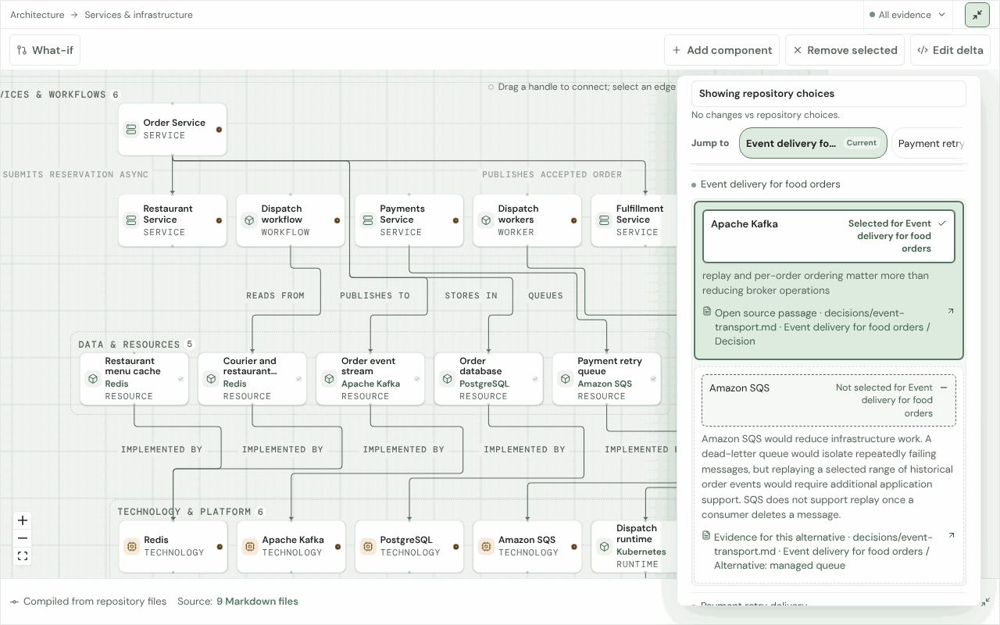
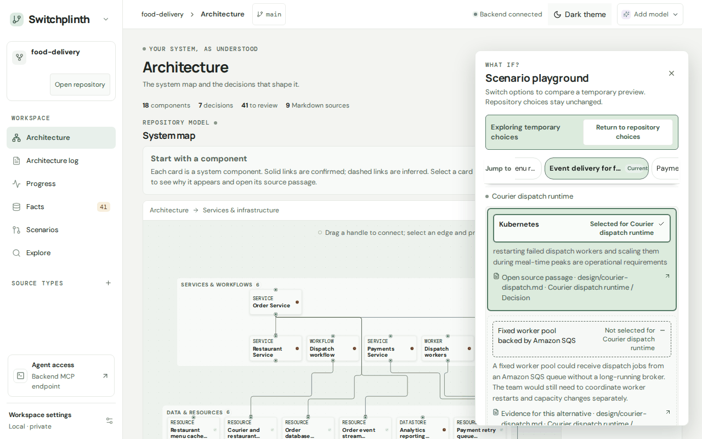
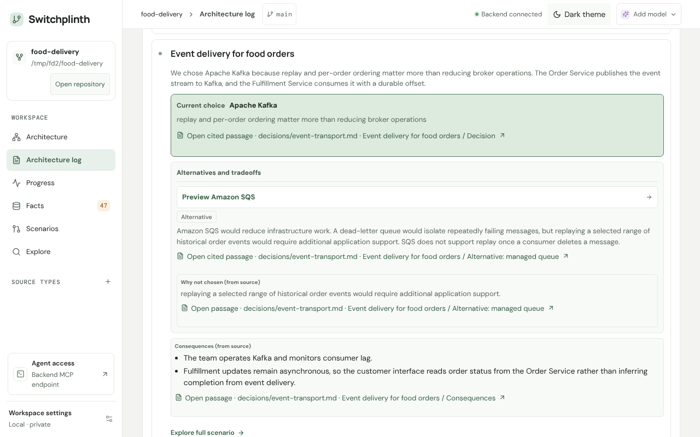
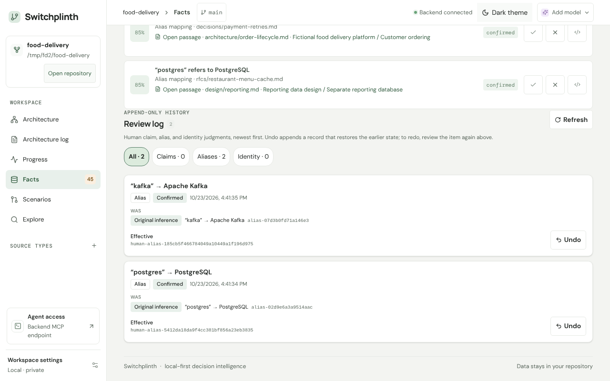
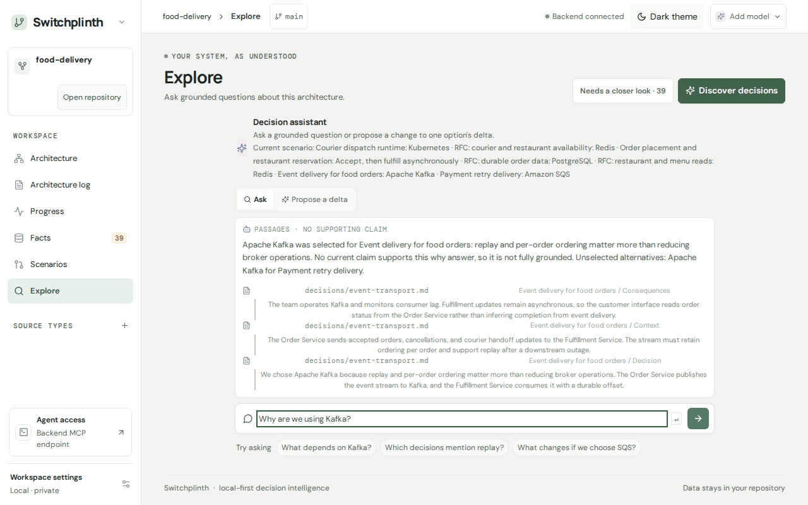

# Switchplinth

Visualize architecture changes from the docs you already wrote.

Switchplinth reads your ADRs, RFCs, and design notes, maps the decisions and the components they touch, and shows what changes when you switch an option. Every inferred fact links to its source passage.

Write an ADR, run Discover, and the decision shows up in the Architecture log with its alternative and why it lost, joins the system map, and can be previewed the other way in What-if.


Recorded with real extraction through Lemonade (Qwen3.6-35B-A3B-ThinkingCoder) by `scripts/record-workflow.sh`: one run on the sample, not a measure of extraction quality. In that run the model attached no graph change to the new decision, so the map and What-if steps show it unchanged. See [Recording the workflow GIF](docs/DEVELOPMENT.md#recording-the-workflow-gif).

Screenshots on this page are captured from the running app on the bundled food-delivery sample (fixture-tuned mock extraction) by `site/scripts/app-screenshots.mjs`; the workflow recording's first step shows the ADR file as it is written.

## Run it

You need Docker with Compose v2 and curl.

```sh
./scripts/demo.sh         # build, load the food-delivery sample, start
./scripts/demo.sh --down  # stop; --purge also deletes the sample
```

Then open <http://localhost:3000>. To extract with a local model, see [model providers](https://bcmyguest.github.io/switchplinth/docs/providers/).

To point Switchplinth at your own repository and register its MCP server with your client, run `cd backend && uv run switchplinth setup` ([setup wizard](docs/DEVELOPMENT.md#setup-wizard)).

## A closer look



The What-if panel previews another option without changing the repository's choice.



The Architecture log shows each decision's reason, its alternatives, and why they lost, quoted from the source.



Your reviews go into an append-only log, and each one can be undone.



Ask why, and the answer lists the source passages it found.



## How it works


- Your Markdown is the input and is never modified.
- Extraction writes decisions, options, and components as YAML under `.decision/`, each citing its passage. The demo's fixture-tuned mock needs no model.
- You confirm, reject, or correct what was inferred. Each judgment is a new record, so re-extraction keeps your reviews.
- Each option is a typed change to one base graph. The compiler applies the selected options to draw the map.
- SQLite and Qdrant indexes are rebuilt from those files and can be deleted at any time.

More detail: [docs/ARCHITECTURE.md](docs/ARCHITECTURE.md).

## Works today

- Markdown discovery, with no template required
- Fixture-tuned mock extraction, and extraction through a local OpenAI-compatible model (tested on small samples)
- The system map, decision options, and What-if previews
- Source passages behind every inferred claim
- Review of claims, aliases, and identities, with an append-only log and undo
- The Architecture log: reasons, rejected alternatives, and consequences
- Saved scenarios: create, list, and load
- Scenario diffs between any two selections, with relationship-based downstream impact (API and MCP); What-if shows the diff against the previous choice
- Capability requirements in scenarios: a component can require a capability such as event replay, and the diff reports when a switch leaves no reachable provider. Switching Kafka to SQS in the sample flags Order Service's replay requirement and names SQS as lacking it (API, MCP, and the Architecture map What-if overlay, which lists appeared and disappeared requirements under "Changes vs previous choice" and the current ones under "Compared with repository choices")
- Input receipts on graph, scenario, search, and diff results, for checking whether the inputs changed
- Search that cites its sources, and an MCP server over HTTP and stdio
- Indexes that rebuild from the files

## Up next

- Testing hosted providers (OpenAI, Anthropic); the adapters exist but are untested
- Measuring extraction recall on more repositories
- Extraction beyond the fixture-tuned mock, which demonstrates the decision model, not extraction quality
- Authentication for remote API and MCP access (both listen on localhost only today)
- Source formats beyond Markdown
- Conflict detection beyond two options writing the same ID
- Renaming, updating, and deleting saved scenarios

## Links

- Website and docs: <https://bcmyguest.github.io/switchplinth/>
- Getting started: <https://bcmyguest.github.io/switchplinth/docs/getting-started/>
- MCP tools: <https://bcmyguest.github.io/switchplinth/docs/mcp/>
- Development notes, full setup, and API behavior: [docs/DEVELOPMENT.md](docs/DEVELOPMENT.md)
- Contributing and agent rules: [AGENTS.md](AGENTS.md)
- Portable file format: [docs/PORTABLE_FORMAT.md](docs/PORTABLE_FORMAT.md)
- Current plan: [docs/V2_PLAN.md](docs/V2_PLAN.md)

Switchplinth is a work in progress. It was built by bcmyguest with AI assistance; coding agents wrote much of the code.

## License

Apache-2.0. See [LICENSE](LICENSE).
