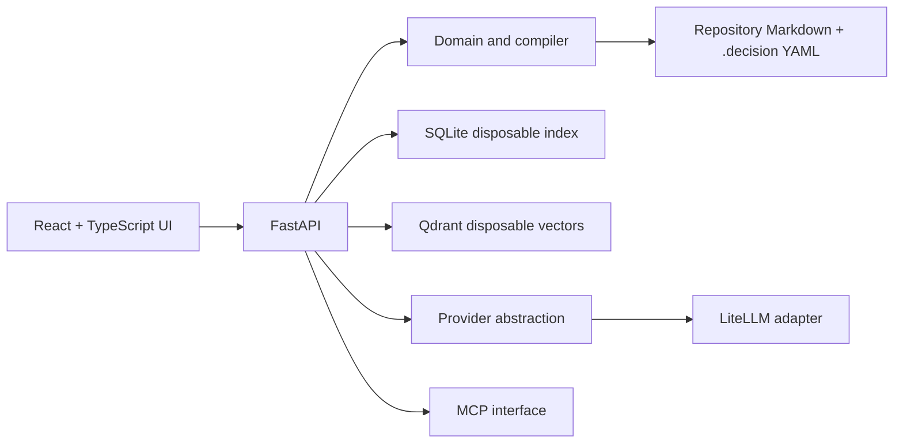

# Architecture

## Runtime shape

Docker Compose runs three distinct services: `frontend`, `backend`, and `qdrant`. The frontend uses React, TypeScript, shadcn/ui, Tailwind, and `@xyflow/react` for graph interaction. YAML theme values compile/map to semantic CSS variables. The backend is Python/FastAPI. SQLite is local disposable state; Qdrant is a disposable vector retrieval index. Neither is authoritative.

The product is **Switchplinth**, formerly the working title **Decision Graph** and the provisional UI label **Waypoint**. The UI, Python package, CLI, MCP server name, and Compose project use the new name.

## Canonical data and compilation

The repository is the durable boundary. Source Markdown remains untouched input. A small `.decision/` tree stores validated, human-readable YAML records and schema files. Evidence anchors are canonical records with reference integrity; claims, aliases, decisions, options, and consequences cite them by ID. The backend loads these plus discovered Markdown into a deterministic domain model, applies precedence rules, compiles graph/scenario views, and rebuilds indexes. UI and conversational edits call domain operations that update the same portable records; YAML edits are validated and reloaded through the same compiler.

The domain/compiler layer must not import SQLite, Qdrant, FastAPI request types, LiteLLM, or LangGraph. Storage and search adapters map between domain records and rebuildable state. Rebuild must be possible with generated state removed. LangGraph is intentionally not used in V0: the synchronous scan has no resumability or human checkpoint flow that needs workflow persistence.

## Claims, precedence, and provenance

Claims carry an epistemic state: `inferred`, `confirmed`, `rejected`, or `asserted` (human override). Machine extraction emits inference claims with evidence anchors and confidence. Human actions create durable records and do not mutate the historical inference into an indistinguishable fact. Effective graph projection filters rejected claims and resolves precedence so asserted/confirmed human decisions outrank inference. Alias records follow the same lifecycle independently of claims about the entity itself.

Identity links use `same_entity_as` claims in the unchanged `decision/v1` claim shape; the schema file is unchanged. The backend validates the schema on every save and identity endpoints on save, read, review, and correction. Endpoint records must be existing, distinct, same-kind base entities. Full cross-record validation runs on reads, not generic saves, so incremental scan and extraction writes remain safe. The predicate is symmetric, and endpoint order does not select a canonical ID. Exact-name matching normalizes case and whitespace. Exact-name candidates remain suggestions and never group identities until a human review through `POST /api/v1/identity-candidates/review` appends a confirmed, asserted, or rejected claim with empty evidence and no source provenance. The operation validates the current candidate pair, joins an existing review chain, returns refreshed groups, suggestions, and conflicts, is idempotent for a repeated active state, and keeps unconflicted rejected candidates visible as human judgments with review actions, while candidates already surfaced as conflicts remain in the conflict view. Inferred claim reviews continue to retain their available evidence and provenance. Only an active human confirmed/asserted link groups a pair. Review is append-only through `reviewed_claim` and `supersedes`; alias review remains separate. Conflicting unsuperseded human judgments, and a rejected pair connected by a confirmed transitive path, surface as conflicts. Positive cycles are harmless; transitive groups are computed at read time, not written as new claims. Graph, search, and entity-detail API responses expose identity groups, suggestions, and conflicts, scoped to entities present in the current scenario. Search uses full claim history for identity review/conflicts; scenario graph compilation uses effective claims.

The API returns identity data, and the frontend presents exact-name candidate actions alongside claim-backed inferred suggestion review. Preserve every stable entity ID and its provenance: no representative ID is chosen, the map does not automatically collapse nodes, and grouping does not copy records or rewrite typed deltas, entity references, aliases, claims, or saved scenario selections. Option-created entities absent from a resolved scenario are not restored by identity grouping. Predicate semantics need no schema version change or migration while the claim shape stays unchanged; any incompatible schema shape change requires an explicit migration.

Evidence identity combines repository-relative source identity, Git blob/commit identity when available, structural heading path, normalized passage hash, and surrounding normalized context. On indexing, exact passage fingerprint is preferred; if changed, structural and context similarity can relocate an anchor. Keep the evidence ID when relocation is sufficiently unambiguous; retain an unresolved/changed state when it is not. Line numbers may be display hints only.

## Scenarios and deltas

An option is a list of typed operations against a base graph, not a copied architecture snapshot. Scenario composition applies selected decision options in stable order to a common graph. Compiler validation checks operation preconditions, referenced entities, duplicate/conflicting writes, and decision dependency constraints. The scenario view derives changed entities and edges, affected decisions, assumptions invalidated, conflicts, and supporting evidence. The same delta payload is read/written by YAML, graphical editing, and conversational AI.

## Discovery, retrieval, and model access

Markdown discovery is deterministic and configurable. Extraction may use rules/mock behavior or a provider. Retrieval combines lexical lookup, Qdrant vector lookup, alias/entity resolution, graph expansion, provenance filtering, and ranking; responses retain links to evidence and claims. When a configured embedding model is available, the same LiteLLM-backed vectorizer indexes passages and embeds queries. Without one, V0 uses deterministic token-hash vectors as an offline fallback; this is not semantic embedding retrieval and the API reports that mode.

Public provider configuration is the application's own versioned schema. An adapter maps it to LiteLLM. Keep model connections (inference, embedding, structured output, streaming) separate from coding/engineering agent connections. Diagnostics report authentication, endpoint reachability, model availability, structured-output support, embedding support, streaming, and latency. `unsupported` means the capability is known unavailable; a capability with no implemented protocol-specific probe is reported as an error with `capability_probe_not_implemented`, meaning unverified. A reachable HTTP 401/403 is an authentication error while endpoint reachability remains supported. Hosted OpenAI and Anthropic adapters use their hosted endpoints; local/custom URLs belong to compatible/local providers. Secret values remain outside committed config.

MCP exposes query operations over the same domain and retrieval services so Codex, Claude Code, and other clients need not depend on UI internals. Local/remote transport and authentication remain unresolved and must be selected before exposing a listener beyond localhost.

LangGraph remains a future seam for workflows that need resumability or human checkpoints, such as long-running extraction/review. It is intentionally absent from V0 because the implemented scan is synchronous and has no persisted workflow or review checkpoint. CRUD, YAML validation, compilation, delta application, indexing, and deterministic retrieval orchestration remain ordinary Python.

## Build and deployment

Use narrow Docker contexts: each service context includes only its subtree and required root files, with caches/build outputs re-ignored. Keep Dockerfiles and Compose understandable. Persist `.decision/` in the opened repository; generated SQLite/Qdrant data lives in disposable volumes/cache locations. Compose publishes UI, API, and Qdrant ports on loopback only and maps `host.docker.internal` to the host gateway for local model servers. The API is unauthenticated, so external listener access remains unresolved and outside the V0 listener contract. Avoid adding services in V0.

## Extension boundary

Later code analysis may contribute evidence and claims such as `implements`, `calls`, `depends_on`, `conforms_to_decision`, and `violates_decision`. V1 does not define or consume a normative `source_kind` field or code-evidence API. A future code-analysis extension needs an explicit schema/API design with a distinct provenance type and must feed the same claim/provenance model. No code-analysis subsystem is part of V0.
